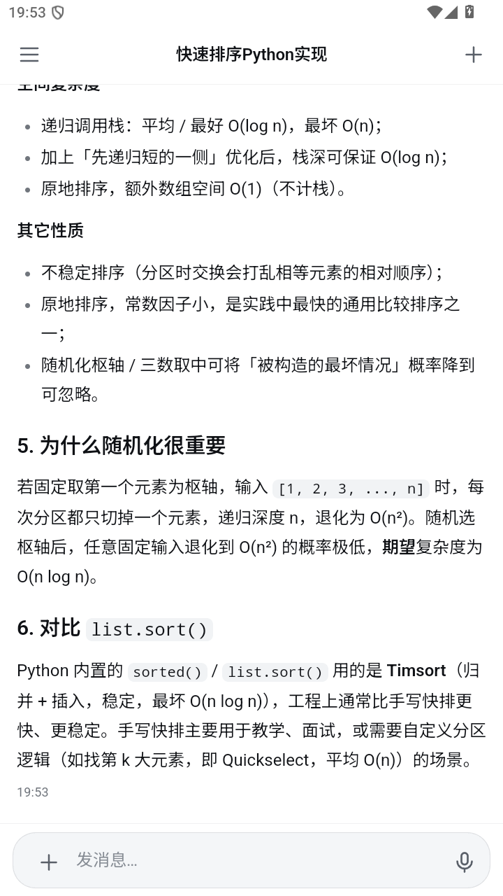
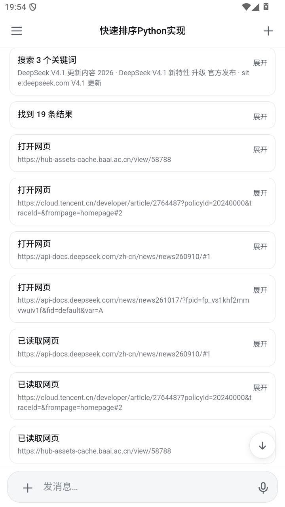
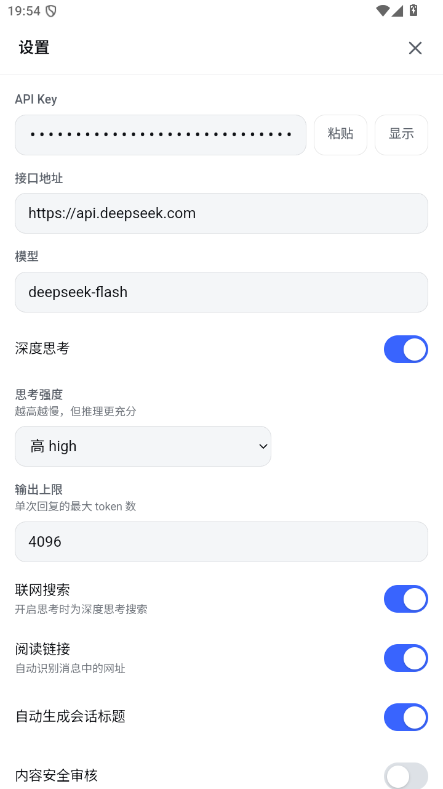

# PureChat

一个**不预置任何提示词**的纯净版 Android 聊天客户端。原生外壳 + WebView 界面，直连模型 API，无中间服务器、无账号体系、无遥测。

<p align="center">
  <a href="https://github.com/md5sy9rg5b/purechat/releases/latest"></a>
  <a href="LICENSE"></a>
</p>

<p align="center">
  
  
  
</p>

## 为什么做这个

市面上的聊天客户端大多会替你加一份隐藏的系统提示词，替你决定模型该怎么说话。本项目反过来：**默认一个字的提示词都不加**，模型收到什么，完全由你决定。

## 纯净的含义

| 项目 | 行为 |
| --- | --- |
| 系统提示词 | **默认不发送**。设置里留空时，请求体中不含 `system` 字段 |
| 内置工具 | 默认不声明联网搜索、链接阅读等任何服务端工具 |
| 行为约束 | 不做角色设定、格式要求、内容过滤提示 |
| 对话上下文 | 只发送你输入的内容与模型自己的回复 |
| 数据流向 | 仅设备 ↔ 你配置的 API 地址 |

想让它带上习惯，就在设置里写系统提示词——**那是你的选择，不是默认行为**。

## 功能

**对话**
- 流式输出，可随时停止；支持重新生成、复制
- 深度思考：独立折叠展示，8 档思考强度
- **编辑提问**：改写后从该轮重新开始
- **编辑回复**：纯本地改写，不调接口；修改后的内容会在下一轮作为历史回传给模型
- **续写回复**：保留原文，让模型接着往下写

**输入**
- Markdown：标题、列表、引用、表格、代码块（语言标签 + 横向滚动）
- 数学公式：KaTeX 离线排版，字体已打包
- 语音输入：ASR 转写回填
- 文件与图片：图片显示缩略图可全屏查看，文档自动解析

**联网**（需手动开启，按 token 计费）
- 联网搜索 / 深度思考搜索
- 阅读消息中的链接
- 搜索结果卡片与引用来源列表

**其它**
- 朗读回答（TTS，两种音色）
- 自动生成会话标题
- 深浅主题、安全区适配
- 会话与设置仅存本地

## 快速开始

### 环境要求

- Android SDK（build-tools 34.0.0、platform android-34）
- **JDK 17**（必须；JDK 21 编译的匿名类会让 d8 崩溃）
- Node.js（仅用于装 KaTeX 依赖）

### 构建

```bash
# 1. 安装前端依赖
cd web && npm install && cd ..

# 2. 构建
pwsh -NoProfile -File build.ps1

# 产物：PureChat.apk
```

无需 Gradle。构建流程是 `aapt2 → javac → d8 → zipalign → apksigner`。

SDK 路径可通过参数覆盖：

```bash
pwsh -File build.ps1 -Sdk "D:\Android\Sdk" -BuildTools "34.0.0"
```

### 其它命令

```bash
pwsh -File build.ps1 -SelfTestOnly   # 只跑纯 JVM 自测（842 项）
pwsh -File build-debug.ps1           # 可调试包（开启 WebView 远程调试）
```

### 直接安装（免构建）

从 [Releases](https://github.com/md5sy9rg5b/purechat/releases/latest) 下载 `PureChat.apk`，
传到手机上安装即可。首次安装需允许「安装未知来源应用」。

```bash
adb install -r PureChat.apk
```

要求 Android 8.0（API 26）及以上。

### 自己构建后安装

```bash
adb push PureChat.apk /data/local/tmp/purechat.apk
adb shell cmd package install -r -t /data/local/tmp/purechat.apk
```

> 首次构建会自动生成签名密钥到 `keystore/purechat.jks`（已加入 .gitignore）。
> 若要发布，请用自己的密钥替换。

## 配置

首次启动会弹出设置面板：

| 字段 | 说明 | 默认值 |
| --- | --- | --- |
| API Key | 模型服务密钥，支持"粘贴"按钮一键填入 | 空 |
| 接口地址 | 仅支持 https | `https://api.deepseek.com` |
| 模型 | 模型名 | `deepseek-flash` |

「校验连接」用 `GET /models` 验证，不产生推理费用。

## 架构

```text
purechat/
├── app/                          Android 原生层
│   ├── AndroidManifest.xml
│   ├── res/                      图标、主题、字符串
│   └── src/app/purechat/
│       ├── MainActivity.java     WebView 宿主、系统栏、安全区与键盘高度
│       ├── Bridge.java           前端 ↔ 原生桥
│       ├── ChatClient.java       HTTPS 直连、SSE 流式读取
│       ├── RequestSpec.java      请求参数校验
│       ├── Store.java            私有键值存储
│       ├── MdBridge.java         Markdown → HTML
│       ├── FilePicker.java       系统文件选择
│       ├── FileUploader.java     Files API 上传
│       ├── TtsClient.java        语音合成
│       ├── TtsPlayer.java        音频播放
│       ├── AsrRecorder.java      录音
│       ├── AsrClient.java        语音识别
│       ├── md/                   纯 Java Markdown 解析器
│       └── netcore/              纯 Java JSON / SSE / 流事件解析
├── web/src/                      界面层
│   ├── index.html
│   ├── styles.css                设计系统
│   └── app.js                    应用逻辑
├── devtest/                      纯 JVM 自测（不打包）
├── docs/
│   ├── THIRD_PARTY.md            第三方许可
│   └── screenshots/
├── build.ps1
└── build-debug.ps1
```

**为什么用原生壳而不是纯网页**：页面以 `file://` 加载，浏览器会以跨域为由拦截直连 API 的请求。把网络请求交给原生 `HttpURLConnection` 既绕开该限制，也能精确控制流式读取与中途取消。

**为什么自己写解析器**：Markdown、JSON、SSE 三个模块均为纯 Java 实现，无第三方依赖，可脱离 Android 直接跑自测。

## 协议

使用 Anthropic 兼容 Messages 接口（`POST /anthropic/v1/messages`）。

```json
{
  "model": "deepseek-flash",
  "messages": [{ "role": "user", "content": "你好" }],
  "max_tokens": 8192,
  "stream": true,
  "thinking": { "type": "enabled" },
  "output_config": { "effort": "high" }
}
```

### 几处容易踩的坑

这些是实现时踩过并验证过的：

1. **思考强度在 `output_config.effort`**，不是顶层 `effort`——顶层会被静默忽略（传非法值也返回 200）。
2. **联网工具的历史必须原样回传**，包括 `kind` 和 `signature`。阅读链接的网页正文只存在 `signature` 里，不回传等于把网页从上下文删掉，模型会凭空作答。
3. **续写对"完整句子"不可靠**：末尾 assistant 消息是完整句时，模型往往整段重写而非接着写，拼接后内容重复。官方文档说明该能力面向"被中断的回复"。
4. **文件回传要每轮完整重建 `image`/`document` 块**，块的位置和形式保持稳定，才不会破坏前缀缓存命中。
5. **`latest_reminder` 紧贴所属 user 消息之前**，`platform` 只接受 `App`/`Web`。
6. **`setDecorFitsSystemWindows(false)` 会让 `adjustResize` 失效**，必须自己读 IME insets 交给页面排版，否则键盘盖住输入框。
7. **`latest_reminder` 要每轮都带并随历史回传**，只在首轮插入会降低上下文缓存命中。
8. **`title` 只在会话首次请求开启**，拿到标题后不再开启，否则每次回答结束都要多等最多 5 秒。
9. **`refusal` 拒答必须处理**：已流式下发的文字无法撤回，要清空已展示内容并换成自己的拒答文案。
10. **每个请求最多引用 20 个文档**，超出返回 400，应在发送前就拦住。
11. **带 `tools` 的请求要回传历史 `thinking` 块**（含 `signature`）。一次回复可能有多个思考块，要按原顺序全部给出；服务端虽会尝试按工具调用 ID 恢复，但恢复不了会直接返回 400。
12. **思考模式下 `temperature` 无效**（固定 1.0），`deepseek-flash` 的 `top_p` 仅在思考模式下生效（下限 0.95）。
13. **`deepseek-v4-pro` 不支持图片输入**，会替换为 `[Unsupported Image]` 文本。

## 测试

```bash
pwsh -File build.ps1 -SelfTestOnly
```

| 模块 | 用例数 | 覆盖 |
| --- | --- | --- |
| Markdown 解析 | 234 | 嵌套标记、未闭合标记、表格、超长输入 |
| JSON / SSE / 流事件 | 510 | 分片到达、CRLF/CR/LF、异常 JSON |
| WAV 封装 / multipart | 98 | 字节级断言 |

全部纯 JVM，可在 CI 中直接运行。

## 隐私

- API Key 与会话都存在应用私有目录（`SharedPreferences`），卸载即清除
- 无统计、无崩溃上报、无后台请求
- release 包关闭了 WebView 远程调试

## 已知限制

- 仅支持 https 接口地址
- 语音、朗读、联网搜索、文件解析均按官方计费规则单独计费
- 续写对已完整的句子效果不稳定（见上文第 3 条）

## 许可

[MIT](LICENSE)。第三方组件许可见 [docs/THIRD_PARTY.md](docs/THIRD_PARTY.md)。

本项目与 DeepSeek、Anthropic 等公司无关联，也未获其背书。